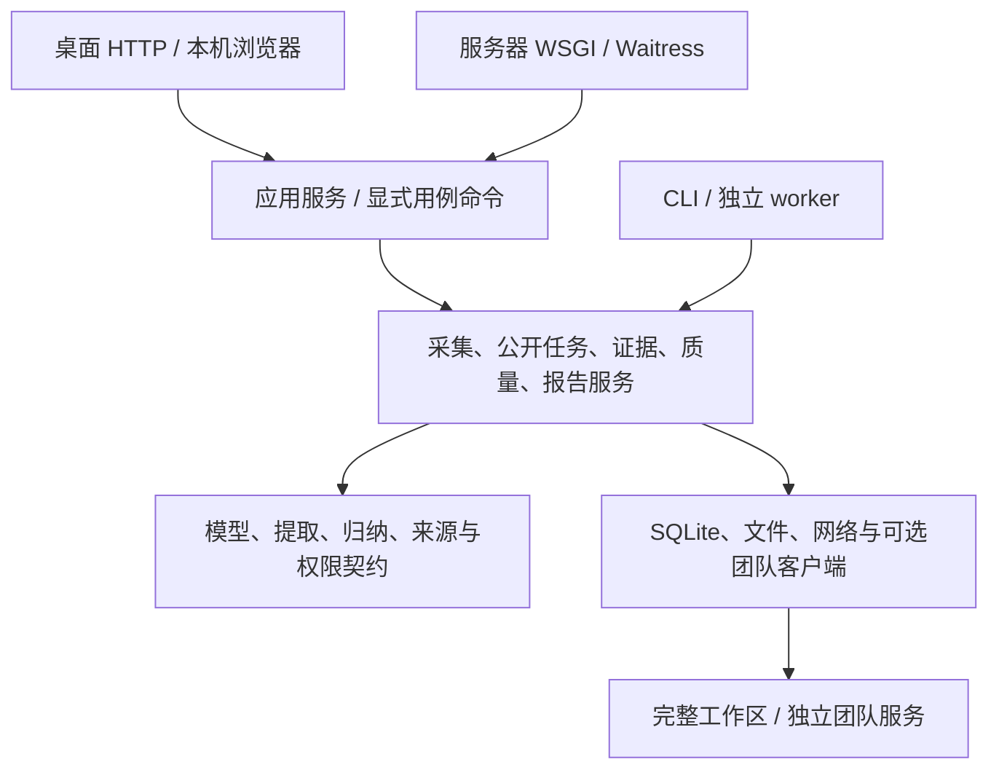

# 当前架构：分层模块化单体

Vibe Job Radar 的核心是保留岗位原文、来源和处理判断，把招聘要求与候选人真实证据分开。桌面工作台、服务器浏览器入口、CLI 和可选团队设备服务使用同一代码仓库；当前选择分层模块化单体，不把采集、报告和个人数据拆成微服务。

原 0.1 设计保留在[历史蓝图](archive/legacy/ARCHITECTURE_LEGACY_01.md)，用于解释最初的证据原则；其中“未来计划”和旧版能力限制不再代表当前实现。本文件描述 0.20.2 的应用命令、报告服务、后台任务与服务器入口代码，实际交付以对应 PR、CI 和发行 Tag 为准。

## 入口和信任边界

| 入口 | 身份和访问边界 | 状态位置 |
| --- | --- | --- |
| 桌面 `workbench.py` / `vibe-radar-ui` | 仅本机 loopback，启动时生成本地令牌；支持桌面浏览器和平台专有能力 | 用户选定的本机工作区 |
| 服务器 `server.py` / `python -m vibe_job_radar.server` | 单拥有者文件密码、Cookie 会话、请求令牌、精确 Host/Origin；远程 HTTPS | 服务器工作区，Docker 为整个 `/data` 卷 |
| 命令行 `cli.py`、`collection.py` | 调用者的本机文件与配置权限 | 显式指定的库、报告与工作区 |
| 独立 `public_worker.py` | 运行已明确确认的公开计划与队列，无 HTTP 登录界面 | 与原工作台一致的持久任务状态和所有权 |
| 团队设备 API `team_service.py` | 独立设备凭据、成员/资源权限、集中配额；不是浏览器工作台账号系统 | 独立服务数据目录，详见[团队服务](TEAM_SERVICE.md) |

服务器入口第一期的个人材料和报告属于同一个拥有者。浏览器可访问服务器不等于已实现多用户私有工作区隔离；团队 API 已有成员角色也不能自动赋予这项能力。桌面入口继续提供原有能力，服务器以显式能力清单限制不能在容器执行的桌面功能。

## 分层与模块职责



| 层 | 主要模块 | 责任 |
| --- | --- | --- |
| 传输与认证 | `workbench.py`、`server.py`、`application_http.py` | 本地/远程认证、来源、请求大小、安全响应头；HTTP 路由/序列化/脱敏错误，监听与进程退出 |
| 共享应用服务 | `application.py`、`application_commands.py` | 组合工作区和业务服务；白名单命令、观察/写入协调、后台任务与统一退出；不持有 HTTP 路由或监听器 |
| 业务用例 | `workspace.py`、`report_repository.py`、`report_tasks.py`、`collection_runtime.py`、`public_tasks.py`、`public_schedule.py`、`public_queue.py`、`evidence_ui.py`、`quality_ui.py` | 导入、采集推进、计划队列、证据映射、人工审阅及报告访问 |
| 领域与报告 | `models.py`、`extract.py`、`synthesis.py`、`pipeline.py`、`report.py` | 数据校验、保守去重、要求与硬约束、样本汇总、证据矩阵及原报告输出 |
| 基础设施 | `store.py`、`network.py`、`guided/`、`team_client.py` 及相关模块 | 持久化、网络策略/代理/TLS、浏览器适配、配额和可选跨设备协调 |

拆分应用服务的目的是让两个 HTTP 入口共用同一业务实现；不是把现有全部代码重写。CLI 仍可直接复用领域和基础服务，不需要绕行 HTTP。平台适配和报告输出保留各自契约，后续新入口不得复制一套更宽松的预算、证据或权限逻辑。

## 核心数据流和不变条件

```text
搜索/公开目录/用户授权文本
  → 线索与正文分级、来源授权和预算
  → JobRecord 校验、SQLite 快照与观察记录
  → 新鲜度/岗位/平台过滤、保守去重
  → 精确原文切分、能力要求和硬约束
  → 规则接收 / 人工审阅 / 可选模型提案
  → 样本内共性差异、候选人证据逐条映射
  → 原 CSV / JSON / Markdown / HTML 报告及哈希清单
```

- 线索不能充当完整 JD；不同来源、合成示例和真实材料不能混淆。记录正文内容变化生成新快照，重复观察保留来源与时间，“当前版本”按采集时间确定。
- 未知公司按来源隔离；跨来源去重保留原来源。原文引用的偏移针对具体正文，模型提案仍须满足 `quote == text[start:end]`。
- direct、contextual、role_related 分开处理，AI 编程样本频次不混入所有一般岗位要求。`rule_score` 不是模型置信概率。
- `sample_frequency(c) = 包含能力 c 的去重职位数 / 有已接收正向 AI 编程正文要求的去重职位数`，按岗位范围计算。这是给定样本内比例，不是全国招聘市场比例。
- 候选人的能力声明不是已满足岗位条件；精确映射需真实材料与人工确认。映射覆盖率不代表学历、年限、生产经验等全部条件已经满足。
- 原报告写入采用暂存和发布边界，保留原报告与失败证据。不能通过去掉持久化、放宽截止时间或重跑 CI 来追认未知历史根因。

## 持久化、并发与任务生命周期

工作区不仅是 `jobs.sqlite`：还包括导入、报告、公开缓存、配额、任务结果、证据、质量审阅、计划和队列状态。桌面、worker 和服务器复用既有 SQLite 与文件所有权协议；Docker 部署必须持久化整个目录，不拆成仅岗位库的卷。

当前部署为单机本地磁盘、一个工作台进程和有界线程。多个浏览器会话共享同一拥有者数据。文件所有权和事务用于阻止重复任务及保持预算一致，不等于已支持共享文件系统、多副本、数据库高可用或任意规模吞吐。

公开查询、类别采集运行器和已确认的计划/队列有服务端生命周期；暂停、重启、时钟回拨、策略改变和不确定结果均沿用原状态机，不能自动重放来掩盖失败。进程退出关闭应用服务和后台执行器；已消耗配额不因 UI 断开、取消或进程重启退款。

`advanced.js` 的采集主表单创建并执行新批次时调用 `/api/collection/create_and_start`，由应用层组合原预检、创建和后台接纳；继续已存在的任务仍调用兼容入口 `/api/collection/background/start`。页面随后观察 `/api/collection/background/state`，暂停通过 `/api/collection/background/pause`。搜索、URL、授权 JSON 源和原公开分类使用同一个 `CollectionRunner`；它持有整个有限任务的工作区所有权，逐步调用原 `Collector.step`，原 step API 与 CLI 继续可用但不能抢占已持有的任务。关闭或刷新网页不会停止已接受的任务；重新打开只观察，不构成新的执行许可。

后台任务保留原检查点和每次请求的预算预留。执行期间检查任务、配置和网络条件，改变后停止；进程重启不会自动重放未确认结果，用户核对后才能继续未完成项。搜索 Key/数据源 Token 仅在当前 worker 内存中使用，不写入任务或状态响应；进程退出、任务结束或暂停后，后续需要凭据的阶段须重新提供。后台化不等于新增无限调度或自动重试。

## 网络、桌面能力与团队服务

网络层继续保留来源许可、robots、公开地址校验、固定连接、TLS 主机验证、预算、有限重定向和失败停止。PAC、代理认证、加密 DNS 与本机系统网络路径依其现有授权和平台依赖工作；新增 HTTP 入口不扩大来源授权，也不绕过招聘平台登录、验证码或权限。

容器不包含 Playwright 或本机浏览器。服务器入口不会接管访问者电脑的 Chrome/Edge、Cookie、系统代理凭据或 Windows 自启动；桌面安装包升级也不在服务器容器内运行。服务器部署和更新边界见 [Docker 说明](DOCKER.md)。

团队服务是可选的集中配额、授权公开快照、设备版本和任务租约接口。它有自己的成员/设备权限与数据库，默认不接收私人简历、Cookie 或报告。将个人工作台部署到服务器是另一条明确的数据边界，不能沿用“个人材料始终在访问者本机”来描述它。当前没有把两个服务合并成多人 SaaS。

## 已有代码、当前交付与待验收

- 已有：证据与报告链路、桌面和 CLI、受控采集与网络策略、公开计划/队列、质量审阅、团队设备服务。保留原有平台和运行模式。
- 0.17.0 已交付共享应用服务边界、单拥有者服务器会话入口、Waitress 和 Docker 持久化部署；其原 HTTP 34 项、页面 17 项、容器 53 项证据保留。0.18.0 扩展高级采集后台执行和双架构镜像发布，实际新增验证见[本版说明](releases/RELEASE_0_18_0.md)。测试使用人工材料，不代表公网 HTTPS 或真实生产服务器已上线；镜像发布及验证边界见 [Docker 说明](DOCKER.md)。
- 后续实现：多用户私人工作区隔离、管理员 Web 管理，以及经过容量证明后才考虑的多副本服务；当前不作这些承诺。当前后台采集仍限本次明确确认的任务，进程重启不会自行恢复请求。
- 外部验收条件：实际 Linux Docker 主机与域名/TLS、所需真实网络/代理环境、获授权的 JD 标注、真实项目及生产指标材料。缺少这些条件的 Issue 保留待验收；软件测试不能替代它们。

历史失败调查与本次可证明的独立修复分别记录。新测试通过只能证明该测试覆盖的行为；未证明的历史存储等待、网络兼容或真实页面原因继续保持未知。

## 报告与命令边界（0.19.0）

`WorkbenchApplication.execute(name, data)` 是无需网页或 socket 的显式用例入口。命令白名单在 `application_commands.py`，HTTP 仅映射 URL 并转换响应；新入口复用同一写入门控，不能任意访问服务私有方法。原 Workspace、同步 `/api/analyze`、`/api/evidence/generate` 与 CLI 接口继续存在。

`ReportRepository` 只访问已发布报告目录，负责列表、受限文件路径和读取；Workspace 保留兼容委托。个人证据状态直接查询该报告边界，不再为了历史报告列表读取当前 `jobs.sqlite`。因此当前岗位库异常不会连带阻断已有证据的读取、保存后响应、导出和基于冻结报告的生成；新的真实分析与当前岗位状态仍会报告实际源库错误。

`ReportTasks` 管理一次明确接受的普通/个人报告任务：启动后由工作线程调用原用例，页面只读状态。持久任务只保存身份、阶段和结果引用，不保存 JD、个人材料或凭据；个人报告沿用 expected_revision、冻结来源、要求语义校验和原暂存发布。任务运行时保留应用写入门控和跨进程报告所有权；退出有界等待，未退出的线程不提前释放锁，升级拒绝进行中的报告。升级助手在整个备份和交接窗口也取得 report_tasks/owner，阻止其他实例开始报告；不长期持有报告记录锁，以便新版构造和就绪确认。

纯观察接口有明确清单，报告状态、证据状态和采集状态可以在报告运行时读取；采集暂停仍由原运行器的锁和所有权控制。其他写操作继续拒绝并发，不能依据 GET/POST 或名称猜测安全性。页面重开只观察，进程失去任务所有权后记录中断，不自动重放、不承诺恰好一次完成。既有报告的暂存、fsync、原子发布与失败保留语义不变。

前端共享 `report_tasks.js` 管理报告状态与当前请求归属；首页与高级页复用，固定历史报告不会被另一个任务完成结果覆盖。队列旧请求结果或失败不能覆盖较新的配置/任务状态；公开计划和队列继续由原后台服务负责。

## 高级工作台业务边界（0.20.0）

高级页分别读取配置、证据和后台状态。`/api/bootstrap` 只提供启动所需配置，不统计岗位库；原 `/api/status` 保持完整状态语义。个人证据服务在首次实际使用时初始化，损坏的个人历史库在证据操作中报错，普通报告和采集入口仍可启动；不会自动重建或修复原库。

草稿版本独立于最近观察的资料版本。上传附件、采集完成或刷新资料不能为未保存内容隐式换成新的版本；保存仍由原后端版本检查处理冲突。重新编辑必须明确采用已保存内容，避免两窗口之间静默覆盖。

创建并执行采集由应用层组合用例调用原预检、创建和后台执行器。页面只提交一次并展示结果；刷新历史失败不再阻断已接纳工作。结果保留已创建任务身份和执行接纳状态；无法确定后台是否接纳时不自动重试，重开只观察，再由用户按原入口继续。配额、所有权、落盘和密钥不持久化的约束保持。


## 分类后续任务的接纳与观察（0.20.1）

高级页的分类下一批和下一页共用一次创建回执处理：先保存后端返回的准确子任务身份和是否新建，再在页面动作锁释放后进入原有继续流程。后台执行仍检查明确授权、任务所有权、关闭状态、访问配置和共享额度；历史列表只是观察，失败不能阻止已确认子任务提交执行，也不能把已接受的执行改报为失败。

异步历史读取独立显示错误，并按当前任务及列表选择核对是否仍可应用结果。后台状态未知的提示不会被历史列表错误替换。已存在子任务不会自动执行；分类恢复和同页重试保持只保存、等待用户继续的原语义。本次不新增采集 API，不改变后台生命周期、配额、原报告或持久化行为。
